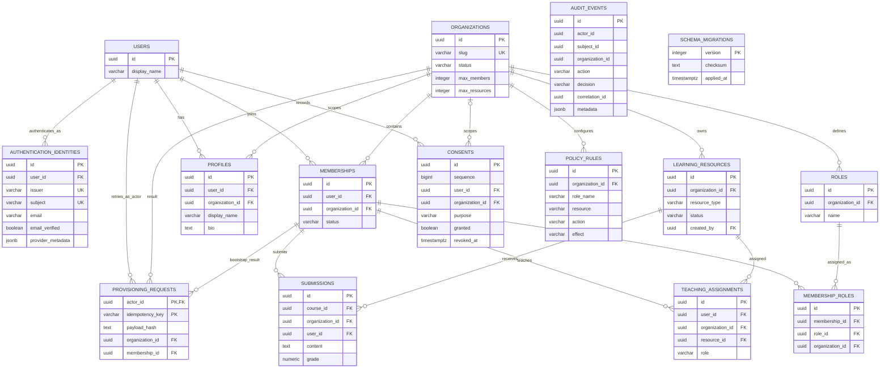

# Domain Model

## Scope and Sources of Truth

This describes the PostgreSQL application schema in `backend/src/db/migrations/001-initial.ts` and `002-boundaries.ts`, with Kysely types in `schema.ts`. Keycloak 26.8.0 has a **separate** database containing provider users, credentials, broker links and sessions. Those provider tables are not application tables in the diagram below.

A platform user is global. An organization is a tenant. Membership connects the two; roles belong to an organization and are assigned to a membership, not globally to a user. The same person can be an admin in one organization and a learner in another.

## Entity Relationships

`UK` on issuer/subject denotes the **combined** unique key, not individual uniqueness. Other combined constraints are listed below. The teaching/submission membership edges are composite `(user_id, organization_id)` references. Audit identifiers deliberately are not FK-enforced relationships; an audit event may describe a denied, absent or historical subject.

## Tables and Important Constraints

| Table | Meaning and Database Guarantees |
|---|---|
| `users` | Global internal identity, display name, timestamps. No tenant column and no password column. |
| `authentication_identities` | FK to user; `UNIQUE(issuer, subject)`. Email is optional metadata, verification is a boolean, provider metadata is nullable JSONB. No email unique key or automatic email-based linking. |
| `organizations` | Unique slug; status `active`, `suspended`, or `archived`; positive member/resource quotas, each default 1000. |
| `memberships` | `UNIQUE(user_id, organization_id)`; status `active`, `inactive`, or `suspended`; additional `(id, organization_id)` unique target for composite references. |
| `roles` | `UNIQUE(organization_id, name)` and `(id, organization_id)`; system-role flag is metadata. Bootstrap creates admin, instructor and learner. |
| `membership_roles` | Unique membership/role pair; composite FKs bind both referenced rows to the stored organization. A trigger derives organization for inserts that omit it. Changing a referenced parent's tenant cannot silently break the relationship. |
| `profiles` | `UNIQUE(user_id, organization_id)`; display name and optional bio. Separate user/org FKs, not a composite FK to membership; the privacy service requires active memberships before sharing. |
| `learning_resources` | Tenant FK; type `course`, `module`, `lesson`, `assignment`; status `draft`, `published`, `archived`; optional creator. Additional `(id, organization_id)` unique reference target. |
| `teaching_assignments` | Unique user/resource pair; role `instructor`, `assistant`, `grader`; composite FKs to tenant membership and tenant resource plus the original same-org trigger. Stored teaching-role labels are not independent Casbin permissions. |
| `submissions` | Composite FKs to tenant resource and tenant member; content and nullable numeric grade constrained to 0..100. Database does not require the referenced resource's `resource_type` to be `course`; the name alone is not such a guarantee. API accepts integer grades. |
| `consents` | Purpose-specific history; generated sequence orders latest decisions. Update/delete trigger enforces append-only normal writes, but allows nested cascade deletion. New rows are constrained to `profile-sharing` or `analytics`; the migration uses `NOT VALID`, so it does not certify old legacy purposes. Organization may be null in schema; current service writes tenant-scoped records. |
| `policy_rules` | Unique `(organization_id, role_name, resource, action, effect)`; effect constrained to allow/deny. Role name is text, not an FK to roles. Public route adds stricter enums. |
| `provisioning_requests` | PK `(actor_id, idempotency_key)`; payload hash and successful organization/bootstrap membership references. Ledger is committed with the organization; it is not a record of all failed attempts. |
| `audit_events` | Time, actor/subject/tenant, action/resource, allow/deny/error, internal reason, correlation ID, IP and metadata. Query indexes; no cryptographic chaining or append-only DB trigger. |
| `schema_migrations` | Version/checksum ledger created by runner; serialized migration execution and checksum checks. Not a business entity. |

## Transactional Behavior

First-login creation takes a transaction advisory lock for `(issuer, subject)`, rereads identity, and commits user and external link together. Uniqueness remains the final database protection. Email verification defaults false unless the validated provider claim is exactly true; an existing identity is returned rather than resynchronized on every login.

Provisioning takes an actor/key advisory lock, compares a normalized payload hash, and atomically creates organization, default roles, initial admin membership/assignment/profile, retry ledger and audit. Same actor/key and same payload returns the existing result; changed payload conflicts. A key is not globally shared across actors.

Member/resource insertion quota triggers lock the organization row and count **all** rows in the tenant, including inactive members or archived resources. They also check moves into a different tenant. Member creation additionally checks count in its transaction. This avoids two concurrent insertions both consuming the last slot. Quotas do not currently describe billing, storage bytes, API rates, or active-user-only limits.

Consent inserts and audit commit together. Sharing uses a repeatable-read transaction, checks caller and target membership, and considers only the latest same-user/same-tenant/same-purpose decision. `analytics` consent never enables profile bio sharing.

## Provider Session Boundary

There is **no local session or device table** in the application schema. `sid`/`session_state` is validated and carried as `AuthenticatedUser.providerSessionId` in request memory. Keycloak persists the provider sessions; the session API obtains their references from Keycloak. `provider_metadata` exists on external identities but is not evidence of session/device persistence and is not populated with a device attestation by current first-login creation.

A provider session identifies a login session, not a physically verified device. IP address and client IDs are useful context, not hardware attestation. No native device registration, secure-hardware proof, or local session ledger is implemented.
