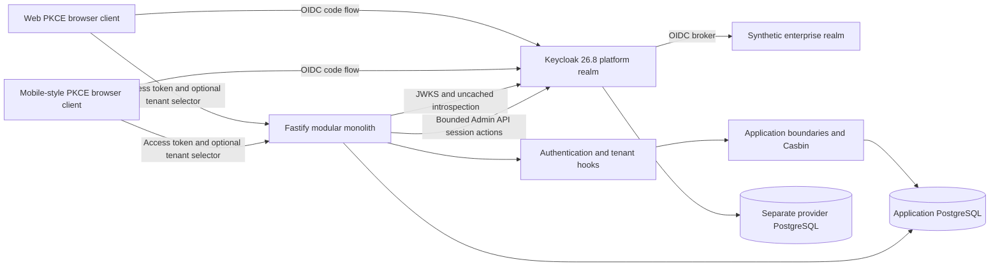
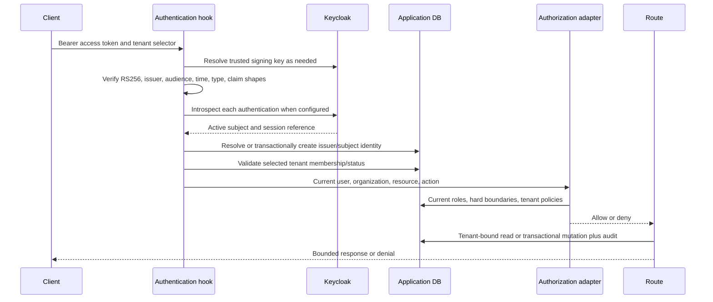

# Repository Explanation and Student Defense Report

## 1. Purpose and Reading Guide

This repository implements a synthetic **multi-tenant identity and authorization platform** using a learning domain to make permissions concrete. A user can belong to multiple organizations, hold different roles in each, read learning resources, submit work, and grade only where authorized. Platform administration provisions and suspends tenants; privacy and session features demonstrate security beyond a basic login.

This report explains the implementation, not just its aspirations. It was prepared by inspecting current `backend/src`, tests, clients, Compose, realm configuration and scripts on **2026-10-02**. The upgraded baseline is Keycloak **26.8.0**, Node **24** (container pin **24.21.0**), Casbin **5.51.1**, Fastify **5.12.5**, JOSE **6.2.12**, Kysely **0.29.6** and PostgreSQL **16** (current Compose patch pin **16.15**; the interim test stack used the earlier 16.3 deployment). Exact npm versions are in `backend/package.json` and the lockfile; deployment images are in Compose/Dockerfile.

Final verification at **2026-10-02T15:56:38Z** passed **159 tests across seven suites, with zero failures and zero skipped tests**, including six live Keycloak lifecycle cases. Typecheck/build passed and npm audit reported zero advisories. Real browser PKCE/broker proof passed using installed Edge, including the first-start stack with separate new volumes. The isolated stack's fixture run separately passed 153 tests with six intentionally skipped live cases. See [verification-evidence.md](verification-evidence.md) for exact commands, output summaries, earlier failures and fixes, and [traceability-matrix.md](traceability-matrix.md) for scope. These results verify the academic baseline, not production readiness or optional extensions.

Recommended order for a student: read this report, trace one request in `middleware.ts`/`routes.ts`, read [domain-model.md](domain-model.md), then [ADR-002](adr/ADR-002-authorization-engine.md) and [threat-model.md](threat-model.md). Finish by explaining a failing security case, not only a successful login.

## 2. Architecture

The backend is a **modular monolith**: one Fastify process, one application database and several logical modules. It is not a collection of independently deployed microservices. Keycloak is a separate identity provider with its own database. The browser demos are separately served static assets.

### Provider vs Application Responsibility

| Keycloak Owns | Application Owns |
|---|---|
| Credentials, provider account authentication, OIDC authorization code/token endpoints | Global platform users and external issuer/subject mapping |
| Platform realm access/ID tokens, signing keys and refresh/session behavior | Organizations, memberships, current tenant roles and tenant policy rows |
| OIDC enterprise broker links and upstream authentication | Learning resources, teaching assignments, submissions and grades |
| Provider sessions, logout/revoke/reset semantics | Purpose-specific consent, field projection, quotas/idempotency and application audit |
| Validated `platform-admin` realm role | Explicit platform operations using that role; it does not imply tenant membership |

Keycloak proves who authenticated. The application decides what that person can do **now** in a particular tenant. Moving tenant roles into long-lived token claims would make changes stale and duplicate the source of truth. The selected design rereads database facts.

### Deployment Shape

`docker-compose.yml` contains five services: application `postgres`, `keycloak-db`, `keycloak`, `backend`, and `clients`. The two databases use separate named volumes and have no published host ports. Provider/API/client ports are bound to loopback at **8180**, **3100** and **5173**. Private container networking is useful isolation, not a substitute for credential management or a production network policy.

The external issuer is `http://localhost:8180/realms/iam-platform`; it must remain the expected token issuer even when the backend fetches keys through `http://keycloak:8080`. `JWKS_URL` and `KEYCLOAK_INTERNAL_URL` permit internal transport without changing the identity being trusted. The session service derives endpoint paths from the issuer/internal base; extra endpoint URL environment variables in Compose should not be assumed to override code that does not read them.

Compose uses Keycloak `start-dev` with HTTP and synthetic defaults. These are deliberate lab choices, not production deployment recommendations. The backend runs migrations, non-destructive synthetic seed, then the compiled server. Existing provider realms are not updated just by `--import-realm`; the configuration script upserts selected settings and checks fixture/link conflicts. Back up an existing provider database before a version upgrade. Do not delete volumes to hide migration or verification failures.

## 3. Repository and File Guide

| Path | Purpose / What a Student Should Explain |
|---|---|
| `docker-compose.yml` | Runtime topology, pinned provider/database images, private DBs, issuer/internal URLs, credentials and readiness checks. |
| `.env.example`, `.env` | Example/local configuration. Actual local env may contain secrets; do not copy it into reports. |
| `backend/package.json`, `package-lock.json` | Exact dependency baseline, Node engine, build/typecheck/test/migrate/seed scripts. Lockfile is part of reproducibility. |
| `backend/Dockerfile`, `.dockerignore` | Node pin, install/build, included test sources, and startup migration/seed sequence. |
| `backend/tsconfig.json`, `vitest.config.ts` | TypeScript and test execution configuration, including environment setup. |
| `backend/src/server.ts` | Fastify bootstrap, Helmet/CORS, logger redaction, body limit, correlation hook, JWKS initialization, error mapping and shutdown. |
| `backend/src/middleware.ts` | Verified bearer identity resolution, untrusted tenant-header validation, current membership checks and required request audit. |
| `backend/src/routes.ts` | Actual HTTP contract and route-specific schema, authorization, SQL filtering and mutation transactions. This file is authoritative for endpoints. |
| `backend/src/common/types.ts` | Authenticated user, tenant/request context, authorization/audit types and typed errors. |
| `backend/src/common/seed-ids.ts` | Shared deterministic identifiers for synthetic users, tenants and resources; identifiers are not secrets or authorization. |
| `backend/src/db/connection.ts`, `schema.ts` | PostgreSQL pool/Kysely singleton and compile-time table types. Database constraints are defined by migrations, not TypeScript alone. |
| `backend/src/db/migrate.ts` | Transactional advisory-locked migration runner, version/checksum ledger and rollback. |
| `backend/src/db/migrations/001-initial.ts` | Base global identity, tenant/membership/role/profile/resource/teaching/consent/audit schema. |
| `backend/src/db/migrations/002-boundaries.ts` | Composite tenant FKs, quotas/triggers, submissions, idempotency ledger, consent ordering/append-only rules and dynamic policy rows. |
| `backend/src/db/seed.ts` | Non-destructive synthetic fixtures for multi-org roles, inactive membership, resources/assignments/submissions. Not general user provisioning. |
| `backend/src/modules/auth/token-validator.ts` | Production JOSE RS256/JWKS verifier, strict claim shapes, access-token type and optional introspection. |
| `backend/src/modules/auth/session-service.ts` | Provider session-reference validation, introspection, separate provider-admin credentials, caller-owned list/revoke/reset. |
| `backend/src/modules/user/user-service.ts` | External identity lookup and concurrent first-login transaction. No email merging and no automatic tenant membership. |
| `backend/src/modules/user/privacy-service.ts` | Purpose-specific consent history and allowlisted profile projection in a consistent read snapshot. |
| `backend/src/modules/organization/membership-service.ts` | Membership/current role lookup and organization listing for the authenticated user. |
| `backend/src/modules/authorization/authorization-engine.ts` | Hard domain boundaries plus fresh Casbin baseline/dynamic policy evaluation. |
| `backend/src/modules/learning-resource/resource-service.ts` | Tenant-bound resource/assignment query helpers. Current routes also contain direct query-builder SQL; these helpers are not the only data path. |
| `backend/src/modules/provisioning/provisioning-service.ts` | Organization/bootstrap idempotency, organization locking, admin/member creation, status transitions and transactional audit helper. |
| `backend/src/modules/audit/audit-service.ts` | Audit insert and filter/query helpers; an optional transaction joins audit to mutations. |
| `backend/tests/setup.ts`, `helpers.ts` | Test environment and signed fixture helpers. A fixture issuer matching production does not make it a real provider-issued token. |
| `backend/tests/security/*.test.ts` | Identity/constraints, strict JWT, Casbin/boundaries, audit, provider lifecycle and provisioning/privacy scenarios. |
| `backend/tests/integration/api.test.ts` | In-process HTTP tests around route/hooks and real DB fixtures, including negative schema/publication/grading cases. Not a real browser login test. |
| `clients/web.html`, `mobile.html`, `style.css` | Two responsive presentation shells, sharing login logic. Mobile is a browser demonstration, not native Android/iOS. |
| `clients/app.js` | PKCE transaction/callback, client-side ID-token signature/claims, in-memory tokens, refresh, tenant selector, resource/member/submission/audit/session request buttons and provider logout. |
| `clients/server.mjs` | Minimal static client server; no backend-for-frontend token session. |
| `infrastructure/keycloak/iam-platform-realm.json` | API/public/admin/test clients, audience/role mappers, provider session/refresh settings, synthetic fixture accounts and enterprise broker. |
| `infrastructure/keycloak/iam-enterprise-realm.json` | Synthetic upstream enterprise OIDC realm/client/accounts. |
| `scripts/configure-keycloak.mjs` | Local operator upsert of imported/existing realms, bounded service-account mappings, fixture conflict checks and explicit test-client gate. |
| `scripts/verify-pkce.mjs` | Playwright real-provider proof path for web/mobile local/broker login, negative PKCE, refresh reuse and session isolation/revocation. No token export. |
| `docs/` | ADRs, domain/threat models, traceability and explanatory/demo documentation. Claims must be checked against current code/evidence. |
| `README.md` and local historical TeX/PDF submissions | README is the published entry-point. Older personal/submission artifacts remain local and are not included in the repository publication; they are not certified execution evidence. |

The modules are logical boundaries, not automatically enforced import restrictions. Some routes orchestrate services; others execute direct Kysely queries. A mentor should ask where checks are located for the **actual route**, not assume every handler uses every helper.

## 4. Identity and Login Flow

### Public Client Authentication

Both `iam-web` and `iam-mobile` are public clients: browser code cannot protect a client secret. They use authorization code + **S256 PKCE**, with direct password grants disabled. The client creates independent random verifier, state and nonce; computes the SHA-256 challenge; and retains only the short-lived redirect transaction in sessionStorage. Tokens stay in JavaScript memory, not localStorage/sessionStorage.

After redirect, the callback removes the stored transaction, clears the query string, checks state, age and optional callback issuer, exchanges the code using its verifier, and verifies the ID-token signature against provider JWKS plus issuer/audience/nonce/time/subject checks. ID tokens establish client login context; **access tokens** go in the API Authorization header. Refresh revalidates the signed identity and preserves the original subject; a refresh ID token may omit nonce, but a present nonce must match. Logout clears local tokens and POSTs to the provider's end-session endpoint, keeping the ID-token hint out of a URL. The tenant selector and request buttons display allow/deny HTTP results without showing tokens; changing selection still does not grant a permission.

This reduces token persistence and code-interception risks, but does not remove XSS risk: malicious code executing in the page can act with in-memory credentials. A page refresh loses the local token state. This is a deliberately small demonstration, not a production OAuth SDK or native secure-storage solution.

Enterprise buttons add `kc_idp_hint=enterprise`, asking the platform realm to broker authentication through the synthetic upstream realm. The API receives a **platform-realm** token. Preconfigured federated links in the fixture are distinct from the application's no-email-merging rule; a new enterprise production onboarding/linking process is not implemented.

### Protected API Request

The token validator requires RS256, configured issuer and backend audience, exp/sub/iss/aud, signed payload `typ=Bearer`, nonempty subject and valid claim shapes. JOSE applies expiration/not-before checks with zero clock tolerance. Optional `iat` is sanity-checked; role structures, email verification, session/broker strings and mixed-type audience arrays are not accepted merely because one value looks valid. `KEYCLOAK_ALLOWED_AZP` enables an additional authorized-party allowlist when configured; it is not an unconditional claim about every deployment.

On first login, user creation locks the issuer/subject key and inserts user/link in one transaction. The database unique constraint is the final safeguard. Equal email addresses on different subjects do not merge users. The validated email_verified boolean is stored on initial creation; existing identities are returned rather than refreshed on every request. No organization membership is automatically granted by first login.

## 5. Tenant Authorization and Policy

`X-Organization-ID` is a **selector supplied by the caller**, not trusted authority. It must be a UUID; the server checks the authenticated user's current membership and organization status. Even a genuine token or a valid tenant ID cannot authorize an arbitrary resource ID. Reads combine resource ID with tenant ID. Lists are scoped by tenant and, for submissions, by owner or taught courses.

Authorization combines three types of facts:

- **RBAC:** current admin/instructor/learner role assignments for this tenant.
- **Attributes:** membership/tenant active state and learning-resource publication status.
- **Relationships:** learner owns submission; instructor teaches referenced course.

Casbin decides role/resource/action/effect after hard boundaries have been checked. Baseline allows live in source; tenant `policy_rules` may add allow or deny rows. A new enforcer loads the selected tenant's rows on each decision. The rule is "at least one matching allow and **no** matching deny" across the complete current role set. Tenant scope is in SQL/application logic, not a `dom` field in this Casbin model. The engine catches storage/evaluation errors and returns denial.

Baseline examples: admin can manage members/policies/read audit/create resources; instructor can read published resources and read/grade taught submissions; learner can read published resources and submit/read own work. All three roles have profile-read/consent-manage baseline entries, but consent's public route intentionally relies on service ownership checks to permit withdrawal during suspension. A policy entry naming an action does not create an endpoint: resource-update baseline permissions exist, but no update-resource route is currently registered.

A platform-admin provider claim authorizes organization provisioning/status routes. It does not bypass a missing tenant membership. A teacher relationship is not an organization-admin role. An allow policy cannot bypass an unpublished-resource, cross-tenant or inactive-state hard deny.

## 6. Actual HTTP Contract

The following routes are registered in `backend/src/routes.ts`. `Tenant` means bearer authentication plus validated `X-Organization-ID`, active membership/organization, and route policy. `Auth` means verified identity without the normal tenant hook. The consent exception validates a tenant selector in its handler and membership in its service.

| Method and Path | Boundary and Behavior |
|---|---|
| `GET /health` | Public process health; not proof of provider/database correctness. |
| `GET /ready` | Public database `SELECT 1`; not a full identity-provider readiness test. |
| `GET /api/v1/me` | Auth; internal userId and user's organization memberships, with audit. |
| `GET /api/v1/organizations` | Auth; same identity/organization payload as `/me`. |
| `POST /api/v1/organizations` | Auth + validated platform-admin; required name/slug/adminUserId and `Idempotency-Key` (8..128 chars), optional positive quotas; atomic bootstrap. |
| `PATCH /api/v1/platform/organizations/:organizationId/status` | Auth + platform-admin; status active/suspended; archived cannot reactivate; no automatic tenant data access. |
| `GET /api/v1/resources` | Tenant; status/type filters, default published, at most 100 rows; non-admin cannot request unpublished statuses. |
| `GET /api/v1/resources/:resourceId` | Tenant; tenant-bound ID/publication/policy checks. |
| `POST /api/v1/resources` | Tenant create policy (admin baseline); title and optional status; creates type course/default draft, quota trigger and audit in transaction. |
| `GET /api/v1/members` | Tenant member-manage policy; returns tenant member ID, user ID, display name, status, not credentials. |
| `POST /api/v1/members` | Tenant member-manage plus service admin recheck; userId and optional learner/instructor/admin role; membership/assignment/profile/audit and quota. |
| `GET /api/v1/audit-events` | Tenant audit-read policy; tenant-filtered events; bounded limit plus optional decision/action filters. |
| `GET /api/v1/submissions` | Tenant list policy; admin sees tenant rows, instructor taught-course rows, other eligible caller own rows; at most 100. |
| `POST /api/v1/submissions` | Tenant submit policy; courseId/content; published tenant resource, authenticated caller is owner; audit in transaction. |
| `GET /api/v1/submissions/:submissionId` | Tenant; owner or taught-course/admin checks; tenant-bound ID. |
| `PATCH /api/v1/submissions/:submissionId/grade` | Tenant; assigned instructor or admin policy; integer grade 0..100; grade and audit share transaction. |
| `GET /api/v1/teaching-assignments` | Tenant submission-list policy; returns caller's own tenant assignment references, not all instructors' assignments. |
| `POST /api/v1/consents` | Auth; UUID tenant selector; purpose profile-sharing/analytics and granted boolean; service validates existing member and active state for grant, permits suspended withdrawal. |
| `GET /api/v1/profiles/:userId` | Tenant profile-read policy; caller and target active members; fixed userId/displayName/bio projection with bio consent gate. |
| `POST /api/v1/policies` | Tenant policy-manage; enum role/resource/action/effect insertion and audit in transaction. No public policy deletion or full policy CRUD. |
| `GET /api/v1/sessions` | Auth; provider sessions for authenticated provider subject only, no tenant header needed. |
| `DELETE /api/v1/sessions/:sessionId` | Auth; provider verifies caller-owned session before deletion; request/completion audits. |
| `POST /api/v1/logout-all` | Auth; provider session reset for caller's subject, request/completion audits. |

Normal invalid credentials return 401; malformed tenant input 400; denied access 403; foreign resource scope can return 404; application dependency/audit errors can return 503. Known conflict cases use 409. These are not a universal guarantee for every database error: the current server's explicit error-code mapping is the authority. Provider failures can be classified as authentication errors and reject with 401. Schemas bound inputs and reject malformed types; no token endpoint, password-reset endpoint, native-device registration or delegated-agent API is provided by this backend.

## 7. Persistence, Transactions and Privacy

The full ER diagram and exact combined constraints are in [domain-model.md](domain-model.md). The key reasoning is that security integrity must survive concurrent requests and parent-row changes, not just the happy path through one API function.

Membership uniqueness prevents duplicates. Composite FKs link both role assignment parents to the same organization and tie teaching/submission rows to tenant membership/resource. Profile/consent tables use simpler FKs, so active-membership sharing checks are explicitly in the privacy service. Resource type `course` in a field name is not a database proof that every referenced resource has that type.

The migration runner takes a transaction advisory lock, stores version/checksum and skips previously applied matching migrations. Changed historical migration checksums fail rather than silently changing an existing schema. The runner does not provide automatic backup, down migration or a complete strategy for arbitrary legacy drift.

Organization provisioning locks `(actor, idempotency key)`, hashes the normalized payload, returns the prior result on equivalent retries, and rejects key reuse with different payload. Org, three roles, initial admin membership/assignment/profile, ledger and audit commit together. A failed audit must not leave a partially provisioned tenant. The public route verifies platform authority; the internal provisioning function is not independently an HTTP authorization boundary.

Quota triggers lock the organization and count all member/resource rows, including inactive/archived ones, before insert or move. This is stronger than an unlocked "count then insert" which lets concurrent requests both consume the last slot. Quota limits are positive and bootstrap membership consumes capacity. Quotas are neither rate limiting nor measured performance guarantees.

Status mutation locks the organization and records audit in the same transaction. A trusted platform-authorized flag comes from the route's verified role check, never from a request body. Normal tenant access stops when the next request sees suspension; in-flight operations are not universally cancelled. Archived organizations cannot reactivate through this service.

Consent stores new rows rather than overwriting past decisions. Generated sequence, not equal timestamps, selects the latest same-user/tenant/purpose decision. Normal update/delete is blocked, with a nested-cascade exception; this is not immutable legal retention. Withdrawal is still available to an existing suspended member through the consent route/service, but granting requires active state. No arbitrary userId in the consent body can redirect the actor's consent to someone else.

Profile sharing runs in a repeatable-read snapshot, checks both active memberships and organization, and returns only a fixed allowlist. Public route asks for userId/displayName/bio; bio appears only with latest profile-sharing grant and no revocation. Analytics consent cannot substitute. Email, identity subject, provider metadata, role internals and audit metadata are not profile fields. This is purpose-limited minimization, not a claim of general privacy-law compliance or erasure/export workflows.

## 8. Sessions, Revocation and Audit Caveats

Keycloak persists sessions. The application only validates `sid`/`session_state` and carries `providerSessionId` in request context; **there is no local persisted session/device table**. The optional `authentication_identities.provider_metadata` column is not a populated hardware/device record. A session ID, IP address or client identifier does not attest a physical device.

Compose enables uncached introspection after signature/claim validation. Authentication requires active=true and subject/session equality with the verified token. Network/non-OK/malformed responses and absent/mismatched session references fail closed. With introspection disabled, an unexpired JWT can remain accepted until expiration after logout. With introspection enabled, revocation responsiveness depends on actual provider state and configuration; live tests must prove this pinned deployment's behavior. Do not claim instant global logout across upstream enterprise SSO or cancellation of in-flight requests.

Backend introspection credentials and provider-admin credentials are separate. The admin client uses client credentials and bounded realm-management roles (manage-users/view-users/query-users), not a realm administrator login; these remain sensitive privileges. Session listing is by authenticated provider subject. Targeted revoke checks ownership before deleting. Logout-all invalidates that provider subject's sessions; it is not password reset. Actual Keycloak 26.8 tests showed password replacement rejects old credentials and accepts new credentials **but keeps the existing access session valid (HTTP 200)**. To revoke it, also perform logout-all. Refresh replay rejected the reused and successor refresh tokens (both 400) and denied the successor issued access token (401), before explicit logout. Final measured logout/revoke/logout-all operation-to-first-denial durations were 62/65/38 ms; the maximum 65 ms across three samples is not a universal SLA, and already-authorized in-flight operations may finish.

Protected reads/denials write application audit with identifiers, action/decision/reason/correlation and available IP. Logger redacts credentials/body and public denial responses avoid detailed policy reasoning. Selected mutations pass the transaction into audit insertion, so audit failure rolls back the mutation. Audit is not automatically emitted by every internal `authorize()` call or by identity creation; route/service composition matters.

Provider side effects cannot be part of a PostgreSQL transaction. Revoke/logout writes request audit before calling the provider and completion audit afterward. A request event only proves an attempt; provider success followed by failed completion audit may leave revoked state despite an error response. The audit table has no hash chain, write-once storage or append-only trigger; no external immutable sink/retention guarantee is implemented.

## 9. Verification and Completion Boundary

Different tests prove different things:

- Signed JOSE fixtures exercise the production verifier; they do not prove provider issuance or browser PKCE.
- Real PostgreSQL tests exercise constraints, transactions, advisory/row locks, rollback and projection; passing typecheck cannot replace them.
- HTTP injection tests exercise registered hooks/handlers and schemas; they do not by themselves establish browser redirect or live introspection.
- Live opt-in Keycloak lifecycle tests use unique synthetic users and configured short-lived test client, checking logout/revoke/logout-all, genuine password reset, refresh expiry/reuse and recording observed existing-token/successor behavior and revocation delay.
- Playwright browser script checks actual web/mobile local and broker redirects, wrong PKCE verifier, signed claims, API identity and own/foreign session behavior. Output avoids secrets/traces.

The application's normal configuration keeps introspection enabled. Synthetic fixture suites explicitly disable it so local signatures are not incorrectly treated as real provider sessions. The test-only direct-grant client is disabled by default and requires `IAM_ALLOW_PASSWORD_GRANT_TESTS=true` plus the configuration flag; this is not the public login design. Reconfigure without the flag after test use to disable it.

For reproducible commands, scopes and evidence slots use [traceability-matrix.md](traceability-matrix.md). Final counts and real-provider results must be inserted by the coordinating verifier. Do not carry forward the old 50-test/Keycloak-24 pass summary as if it verified these new boundaries.

## 10. Mentor Questions and Suggested Responses

| Mentor Question | Student Response Grounded in Code |
|---|---|
| Why not call this microservices? | Modules share one backend process/database and transactions. Keycloak is an external service; splitting files is not independent service deployment. |
| What makes the tenant header trustworthy? | Nothing by itself. UUID validation checks syntax; membership/org status and tenant-scoped SQL establish authority for this verified caller. |
| Why not authorize using token tenant roles? | App DB is authoritative for tenant roles/teaching/status. Current queries avoid stale grants after changes. The validated provider platform role has a narrow separate purpose. |
| Why reject an ID token with a valid signature? | It is intended for client login context, not API authorization. API requires backend audience and signed Bearer access-token type. |
| What does PKCE add for a public client? | A stolen authorization code cannot be exchanged without the original verifier. State binds callback to browser transaction; nonce binds ID token. They solve different problems. |
| Can the same email safely link accounts? | Not automatically. Identity is issuer/subject; email can change or be unverified. Explicit provider fixture links do not imply app email matching. |
| How does deny precedence work with two roles? | Casbin sees the role set together. Any matching deny makes the effect false even if another role or baseline allows. Hard DB boundaries run first. |
| Does Casbin enforce the tenant domain itself? | Not this model. Adapter queries membership and policy rows for the organization before evaluating roles/object/action; SQL performs tenant isolation. |
| How is instructor access different from learner access? | Instructor individual read/grade requires teaching relationship; list SQL filters taught courses. Learner read/list is owner-filtered and grading lacks baseline allow. |
| Why add composite FKs if there are triggers? | They protect the linked organization values and referenced parent moves, which a child-only insert trigger does not fully cover. |
| What happens if two requests hit the last quota slot? | Both serialize on the org row; the second count sees the committed first insert or follows rollback. Correctness is tested concurrently, not inferred from sequential tests. |
| Is an idempotency key global? | No, it is scoped to actor. The stored payload hash rejects a changed request under the same actor/key; successful result and ledger commit atomically. |
| Can suspension prevent withdrawing consent? | The public consent path intentionally authenticates without active-only tenant hook and checks membership in service; granting needs active state, withdrawal only an existing member. |
| Does analytics consent enable profile bio? | No. Latest profile-sharing consent alone gates requested bio. Projection never serializes full identity records. |
| Does a session ID prove a device? | No. It references provider session state. There is no local device table or hardware attestation. |
| Is logout immediately effective for every issued JWT? | Only configured introspection can check provider activity on the next request; provider behavior must be demonstrated. JWT-only verification accepts valid unexpired tokens. In-flight/upstream sessions are separate caveats. |
| What if audit fails after provider revoke? | The revoke may already have happened; it cannot roll back with DB. Request and completion audits distinguish attempted from confirmed side effects. |
| What does zero npm audit prove? | No known matched advisories at that time, not absence of authorization bugs, safe configuration, or successful provider lifecycle. |
| Which requested extensions are not present? | Application service principals/agents/delegation, native/hardware device assurance and performance benchmarks. Provider-admin service account is infrastructure, not AG01/AG02. |

## 11. Student Explain-and-Demonstrate Exercise

1. Draw the trust boundaries without looking at this report. Identify the two databases, external issuer, internal provider URL and which store owns tenant permissions.
2. Trace `GET /resources/:resourceId` from bearer extraction to response/audit. Explain why a valid Acme header plus Globex resource ID cannot succeed even for Acme admin.
3. Contrast three identities: Alice's platform-admin claim, Alice's Acme admin membership and Alice's Globex learner membership. Explain why one does not replace the others.
4. Read the Casbin effect expression aloud and predict an allow+deny combination for a multi-role member. Identify where dynamic rows are selected and why they cannot bypass hard boundaries.
5. Demonstrate a real PKCE login and one negative verifier case using the approved synthetic environment. Describe evidence without revealing tokens, passwords, codes or cookies.
6. Demonstrate the difference between a locally signed verifier test and a real provider logout/revocation test. Explain why introspection must remain enabled for the latter claim.
7. Explain one quota race and one idempotency retry from transaction begin through commit/rollback. Name the SQL lock and the permanent database constraint/ledger involved.
8. Predict profile output before grant, after profile-sharing grant, after analytics-only grant, and after withdrawal. Explain the suspended-withdrawal exception and repeatable-read consistency boundary.
9. Find an actual limitation in source: no policy deletion route, no persisted device table, no universally atomic permission recheck at mutation commit, or no immutable audit sink. Explain its consequence rather than describing planned work as complete.
10. Fill a T01-T13 evidence row using a real dated run: command, environment, observed result, skips and the exact behavior proved. A screenshot of "Signed in" alone is insufficient evidence for all lifecycle claims.

Students should be able to answer in their own words and locate the implementing function/test. Memorizing this table is not equivalent to understanding the code.

## 12. AI Assistance Disclosure

This explanatory Markdown report and its companion domain/threat/ADR/traceability updates were prepared with AI assistance, using the repository source and supplied verification status. AI assistance is not independent validation. The implementation work in this shared session also includes AI-assisted engineering; this report does not assign unverified authorship percentages or claim that a student personally wrote every line.

The submitting student remains responsible for reviewing the code, running/reproducing evidence, correcting inaccurate claims, meeting course disclosure requirements and explaining design decisions without relying on generated prose. Final tests and provider proof belong in the traceability evidence log. Unknown or unexecuted checks must stay marked as such.

## 13. Explicit Non-Goals and Remaining Risks

Optional application service-principal authentication, delegated agents with delegator permission-loss enforcement, native mobile secure storage/hardware attestation, real enterprise tenant onboarding and performance/load benchmarks are **NOT IMPLEMENTED**. Basic provider-admin infrastructure must not be relabeled as these features.

Production readiness also needs TLS and secure provider mode, replacement of synthetic secrets/accounts, broader operational hardening, rate limiting, backup/restore/retention procedures, explicit in-flight authorization consistency policy, robust policy administration and independently reviewed security evidence. These are limitations, not evidence that the demonstrated core behavior is complete or defective by itself.
