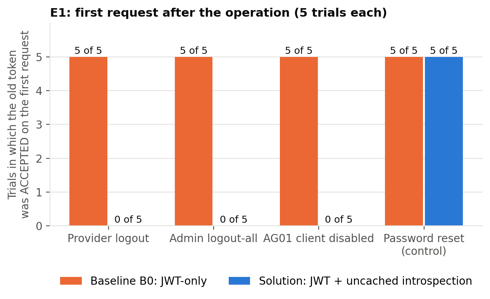
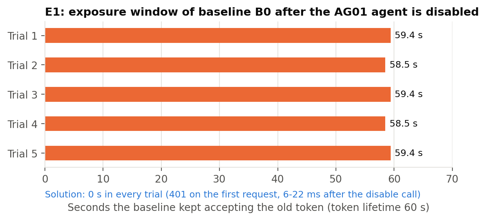
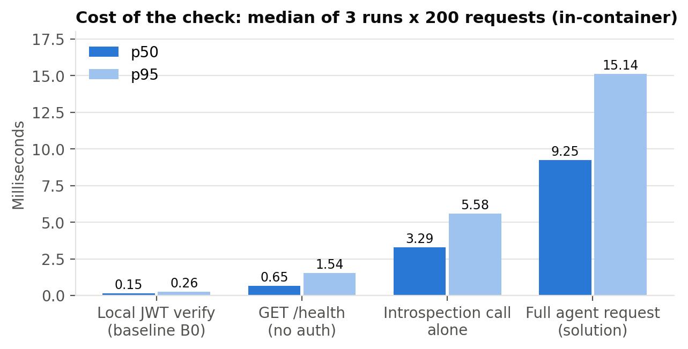
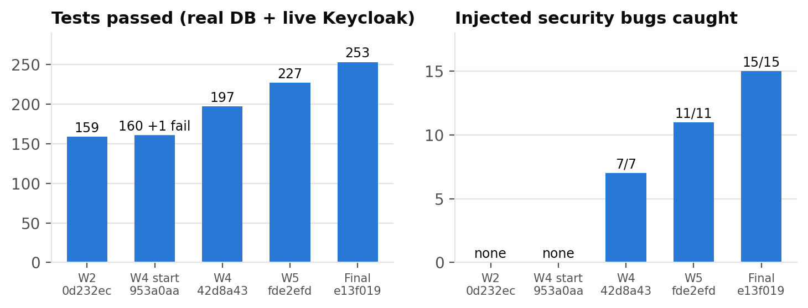
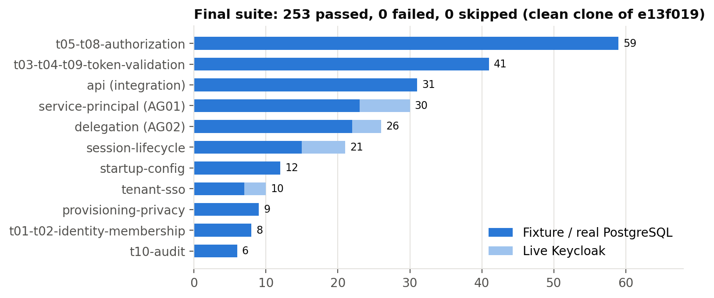

# Evaluation: experiments, baselines and raw results

This folder holds the evaluation material the final submission guide (§4, "evaluation/") asks for.
It has the evaluation questions, the baseline, the workloads, the exact scripts, the raw result
files and how to regenerate every reported number and figure. The functional acceptance tests live
in `backend/tests/` and the evidence of earlier runs in `docs/evidence/<date>/`.

## Evaluation questions

| ID | Question | Metric (unit) | Pass threshold (frozen 10 Oct, `docs/evaluation-protocol.md`) |
|---|---|---|---|
| Q1 | Do all frozen acceptance tests pass from a clean clone? | tests passed / failed / skipped | 0 failed, 0 skipped (skips are not passes) |
| Q2 | Are the tests able to fail? | injected security bugs killed / total | every mutation killed; a stopped DB must be *inconclusive* (exit 2), never success |
| Q3 | Is a revoked session or agent refused on the next request? Compare against the baseline. | first-request status; seconds a revoked token keeps working; accepted requests after revocation | solution: 401 on the first request, ≤ 5,000 ms, 0 accepted afterwards |
| Q4 | What does the per-request check cost? | p50 / p95 latency (ms) | observation only (no target was set; nothing is optimised) |
| Q5 | Does the real-browser flow hold on two host names? | browser checks passed | 11 / 11 on `localhost` and `127.0.0.1` |
| Q6 | Does AG02 never exceed the user's permission? | outcome table | as specified in ADR-014 / `docs/adr/ADR-004` |

## Baseline definitions

- **B0, JWT-only validation (security baseline, experiment E1).** The common shortcut: accept any
  access token whose RS256 signature, issuer, audience, expiry and `typ=Bearer` verify against the
  provider's JWKS. There is no introspection. This is exactly the first half of our own validator
  (`backend/src/modules/auth/token-validator.ts`). B0 is implemented inline in
  `scripts/baseline-revocation.mjs` with the same `jose` library and options, and runs against the
  same live tokens as the solution.
- **Solution S1.** The running API: JWT checks plus uncached provider introspection, then tenant
  context, hard boundaries and Casbin (`docs/Architecture_Decision_Records.md`, ADR-005).
- **Revision baseline (Q1/Q2).** The Week 3 head `953a0aa`, rerun on 31 Oct before any fix:
  160 passed, **1 failed**, 6 skipped, with no working mutation check. Raw log:
  `docs/evidence/2026-10-31/baseline-953a0aa.log`.
- **Guard-removed baselines (Q2).** Each mutation M1–M15 is the solution with exactly one security
  guard removed. That is a "naive implementation" baseline for each guard. A mutation is killed when
  the named tests fail against it.

## Workloads and data

All data is **synthetic** and lives in the repository. There are two realms
(`infrastructure/keycloak/*.json`) and a seed (`backend/src/db/seed.ts`) with 3 tenants, 5 users,
courses and submissions. E1 creates a fresh, uniquely named user (`eval-<uuid>`) for each trial and
deletes it, and the app rows it created, afterwards. There are no external datasets, no API keys
and no cost.

| Experiment | Workload | Repeats |
|---|---|---|
| E1 baseline vs solution | 4 operations (provider logout, admin logout-all, AG01 client disabled, password reset as a control) × 5 trials. After the operation, the same token goes to B0 and S1 once immediately, then every 1 s until it expires | 20 trials, 403 polls |
| Latency (Q4) | `GET /health`, introspection alone, AG01 `GET /resources`: 3 runs × 200 sequential requests after 20 warm-up, in-container. Plus 500 local B0 verifications | 3 runs |
| Full suite (Q1) | 253 tests in 11 files, real PostgreSQL + live Keycloak | 1 per revision |
| Mutations (Q2) | 15 mutations, one at a time, plus a database-down control | 1 per revision |

## Environment (all runs)

Windows 11 Home, Docker Desktop (Linux containers), host Node 24.20.0. Images:
`node:24.21.0-alpine`, `postgres:16.15-alpine`, `quay.io/keycloak/keycloak:26.8.0`. Backend
dependencies are pinned by `backend/package-lock.json` (Fastify 5.12.8, Casbin 5.51.1, jose 6.2.12,
Vitest 5.0.3). Browser: Microsoft Edge through Playwright 1.63.0. There is no randomness to seed:
the fixtures are fixed UUIDs, and E1 user names are random but do not affect any outcome.

## Results

### E1, baseline vs solution (2026-11-16, code identical to `e13f019`)
Raw: [`results/2026-11-16/e1-baseline-revocation.jsonl`](results/2026-11-16/e1-baseline-revocation.jsonl) ·
summary: [`results/2026-11-16/summary.csv`](results/2026-11-16/summary.csv)

| Operation (5 trials each) | Valid before | B0 accepts the 1st request after | S1 1st request | S1 median time to 401 | B0 accepted afterwards | S1 accepted afterwards |
|---|---|---|---|---|---|---|
| Provider logout | 5/5 | **5/5** | **401 ×5** | 22 ms | 15 / 30 polls | **0** |
| Admin logout-all | 5/5 | **5/5** | **401 ×5** | 13 ms | 15 / 30 polls | **0** |
| AG01 client disabled (60 s tokens) | 5/5 | **5/5** | **401 ×5** | 7 ms | **298 / 313 polls, median 59.4 s** | **0** |
| Password reset (control, not a revocation) | 5/5 | 5/5 | 200 ×5 | — | 15 / 30 | 15 / 30 |




Observations:
- The baseline cannot see revocation at all. It accepts a revoked token until the token's `exp`.
  For agents that is the full 60 s. For human web/mobile tokens the realm lifespan is 300 s, so
  B0's exposure would be up to 5 minutes. (The human trials use the opt-in `iam-test` client,
  whose sessions are capped at 3 s for expiry tests. That is why the human trials show only about
  2 s of polling.)
- **The control shows a real limit of the solution, too.** A password reset alone does not end
  existing sessions in Keycloak, so S1 keeps accepting the old token, exactly like B0. This is why
  incident response must call logout-all. It matches the frozen protocol criterion 3 and the live
  test in `session-lifecycle.test.ts`.

### Cost of the check (Q4)
Raw: `docs/evidence/2026-11-14/latency.log` (in-container, 3 × 200 requests) and the `E1-cost` line of
the E1 file (500 local verifications).

| Series | p50 (ms) | p95 (ms) |
|---|---|---|
| Local JWT verification (B0) | 0.15 | 0.28 |
| `GET /health` (no auth) | 0.65 | 1.54 |
| Introspection call alone | 3.29 | 5.58 |
| Full AG01 request (S1: JWT + introspection + registry + tenant gate + grant + query + audit) | 9.25 | 15.14 |



Introspection is about a third of an authenticated request. That is the measured price of Q3. It is
a single-machine, sequential observation, not a throughput benchmark.

### Verification over revisions (Q1, Q2)

| Revision | Date | Passed / failed / skipped | Mutations killed | Evidence |
|---|---|---|---|---|
| `0d232ec` (W2) | 2 Oct | 159 / 0 / 0 (build context, not a clean clone) | — | report only |
| `953a0aa` (W3 head, revision baseline) | 31 Oct rerun | 160 / **1** / 6 | — | `docs/evidence/2026-10-31/baseline-953a0aa.log` |
| `42d8a43` (W4) | 31 Oct | 197 / 0 / 0 | 7 / 7 | `docs/evidence/2026-10-31/` |
| `fde2efd` (W5) | 7 Nov | 227 / 0 / 0 | 11 / 11 | `docs/evidence/2026-11-07/` |
| **`e13f019` (final)** | **14 Nov** | **253 / 0 / 0** | **15 / 15**, DB-down → exit 2 | `docs/evidence/2026-11-14/` |




### Tests not run (disclosed)
- No independent rerun on a second machine (planned for the second team member; not done).
- No concurrency or throughput load test. Latency is sequential only.
- No iOS / Safari run. The physical-phone run (Android Chrome, 7 Nov) predates AG02.
- Experiment E1 ran on the development stack (normal volumes) on 16 Nov, not inside a clean clone.
  The backend source on that stack is identical to `e13f019`.

## Reproduce

Everything below needs only Docker Desktop and Node ≥ 24.

```powershell
docker compose up -d --build --wait

# E1: baseline vs solution (about 6 minutes; the 5 agent trials take about 62 s each)
$env:IAM_ALLOW_PASSWORD_GRANT_TESTS = "true"; node scripts/configure-keycloak.mjs --enable-test-client
Get-Content evaluation/scripts/baseline-revocation.mjs | docker compose exec -T backend node --input-type=module - | Out-File -Encoding utf8 evaluation/results/<date>/e1-baseline-revocation.jsonl
node scripts/configure-keycloak.mjs; Remove-Item Env:IAM_ALLOW_PASSWORD_GRANT_TESTS

# Latency observation
Get-Content scripts/measure-latency.mjs | docker compose exec -T backend node --input-type=module -

# Figures + summary.csv from the raw files (needs Python 3 + matplotlib)
python evaluation/scripts/make_figures.py evaluation/results/<date>

# Whole clean-state run (fresh clone, new volumes, all checks; stop your normal stack first)
powershell -ExecutionPolicy Bypass -File evaluation/run-clean-evaluation.ps1 -Revision cs5903-final-2026 -BrowserChannel msedge
```

The E1 script exits 0 only if every revocation trial gives 401 on the first request and the token
was valid beforehand.
